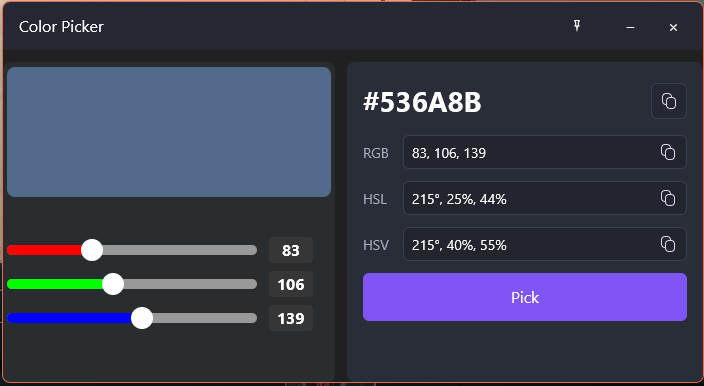
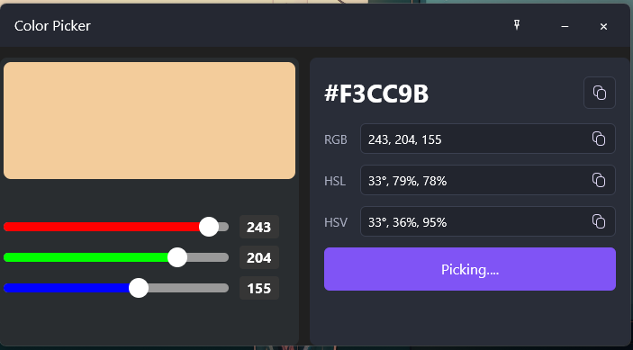

# Color Picker

A simple Windows color picker built with Rust and GPUI. Pick colors from your screen, adjust RGB values, and copy colors in HEX, RGB, HSL, or HSV format.

## Screenshots





## Features

- Pick colors from anywhere on your screen outside the app.
- Adjust red, green, and blue values with sliders.
- Preview colors and view HEX, RGB, HSL, and HSV values.
- Copy color values to the clipboard.
- Pin the window above other apps.

## Usage

1. Click **Pick** to enter picking mode.
2. Click outside the app to sample a color. The preview, sliders, and color values update.
3. Click **Picking....** to stop picking.
4. Use the sliders to adjust the color, or click a copy icon to copy a value.
5. Use the pin button in the title bar to toggle always-on-top mode.

## Build and run

Requires Windows, Rust with Cargo, and Visual Studio Build Tools with the C++ build tools and Windows SDK.

Run a development build:

```powershell
cargo run
```

Build an optimized release:

```powershell
cargo build --release
```

The executable is saved to `target\release\color_picker.exe`.
